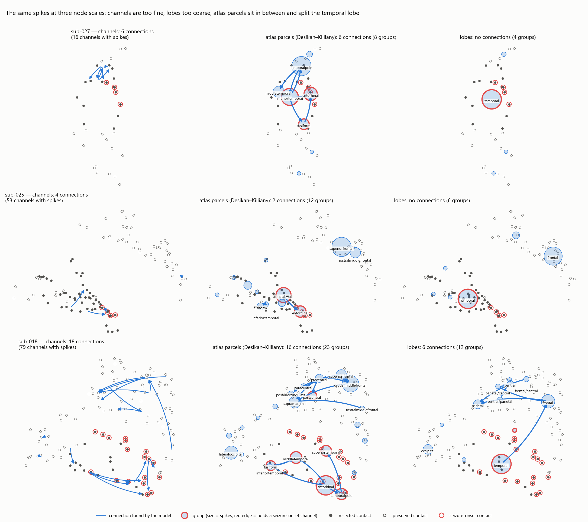

# Mock test — three patients through the whole pipeline

**Date:** 2026-10-18 · **Dataset:** ds007118 · **Patients:** sub-027 (first mock, acq-B), sub-025, sub-018
**Status:** exploratory. Three patients, no agreed ranking rule (Q15) — this
describes what the graphs are made of, not how well the method works.

---

## In one paragraph

We ran two more seizure-free patients through the same detector and network
model as sub-027, unchanged, and looked at what every edge is made of. **The
detector keeps working**: on all three patients the busiest channels are
seizure-onset channels. **The model mostly does not**: on these 30-minute
recordings most channels have too few spikes to fit, and for the rest BIC picks
a penalty one or two steps from the empty model, so nearly every channel gets
*at most one* incoming arrow. The edges that survive are of three kinds — one discharge
seen on neighbouring channels a few ms apart, edges resting on a handful of
coincidences, and (on sub-018 only) genuine lead–lag sequences. **On all three
patients, simply picking the busiest channels lands on the seizure-onset zone
at least as often as the network's hubs.** sub-018 is the encouraging case: its
top hub is a seizure-onset channel that fires *first*, 10–30 ms ahead of the
others, which spike rate alone ranks only 11th.

---

## What was run

Same code, same settings for all three (bipolar montage of physically adjacent
contacts, `spikedet.py` defaults, 19.5-ms bins, 5 self + 5 cross lags,
group lasso, BIC). Whole recording, no time window chosen.

| | sub-027 (acq-B) | sub-025 | sub-018 |
|---|---|---|---|
| Outcome | ILAE 1, SOZ fully resected | ILAE 1, SOZ fully resected | ILAE 1, SOZ fully resected |
| Recording | 34 min, 36 contacts | 32 min, 112 contacts | 37 min, 128 contacts |
| Bipolar channels (with spikes) | 22 (16) | 64 (53) | 88 (79) |
| SOZ channels / channels touching resected tissue | 4 / 11 of 16 active | 5 / 26 of 53 active | 15 / 25 of 79 active |
| Spikes detected | 1,103 | 692 | 2,078 |
| Densest channel, events per parameter | 2.0 | 0.3 | 0.6 |
| Detector / model time (channel arm) | 9 s / 85 s | 23 s / 146 s | 39 s / 985 s |

All three are **temporal-lobe** patients: every SOZ contact is in the temporal lobe.

Why these two: both seizure-free with the SOZ completely removed, so the
surgical labels mean something. **sub-025** was step 1 of `plan.md` (busy:
70 contacts labelled spiking). **sub-018** has many SOZ contacts (18) and a focal resection (33 of 128 contacts), so "in the
resection" is a stricter test than on the others.

## The graphs

| sub-027 | sub-025 | sub-018 |
|---|---|---|
|  |  |  |

Left half of each figure: spike rate per channel, coloured by the clinicians'
label. Right half: contacts (filled = resected, red ring = SOZ) and the
network, drawn between channel midpoints.

---

## What we found

### 1. The detector agrees with the clinicians on every patient ✅

The busiest channels are SOZ channels on all three: sub-027's top 8 are all
spiking/SOZ; sub-025's top 2 (A8-A9, A6-A7) and sub-018's top 3 (A14-A15,
A13-A14, A17-A18) are SOZ. One oddity: on sub-025 the 48 channels clinicians
marked *spiking* fire no more than the *normal* ones (median 0.13 vs 0.16
spikes/min) — our detector and their marking disagree there.

### 2. Most channels cannot be modelled, and nearly all the rest get at most one arrow ⚠️

| | fitted with coefficients | intercept-only | fit failed (too few spikes) | no spikes |
|---|---|---|---|---|
| sub-027 | 8 | 4 | 4 | 6 |
| sub-025 | **4** | 16 | **33** | 11 |
| sub-018 | 17 | 27 | **35** | 9 |

And where a fit succeeds, BIC lands almost at the empty-model end of its
penalty path — on sub-018, 27 of 44 fitted channels at step 1 (nothing kept),
16 at step 2–3, only 1 beyond. One or two steps from empty, a target can admit
only its single strongest predictor. On sub-025 and sub-018 even a channel's
own spiking history is dropped (self-history is non-zero in only 1 fitted
channel each; 3 of 8 on sub-027). **This is the main
reason the graphs look the way they do**: nearly every channel has 0 or 1
incoming arrow (only 3 channels across the three patients have 2), so the
network is a set of stars and short chains, not a web.

The cause is data volume. A 30-minute recording gives 0.3–2 events per model
parameter on the densest channel; the usual floor is 10–20 (P-09).

### 3. Three kinds of edge — only one is "influence" ⚠️

Behind each edge, the raw spike times (`*/edge_check.txt`, `mock_summary.txt`):

| Kind | What it is | Examples |
|---|---|---|
| **One discharge seen twice** | Two neighbouring channels catch the same spike < 20 ms apart; whichever peaks first is called the source (P-29) | 5 of 6 on sub-027; A14-A15 → A13-A14 on sub-018 (78 of 119 co-firings in the *same* bin) |
| **A handful of coincidences** | Edge rests on 4–6 events, sometimes from a near-silent source | sub-025 A1-A2 → B13-B14 (source has **3 spikes**; strongest edge in that patient); sub-018 A47-A48 → B44-B45 (source has 2) |
| **Consistent lead–lag** | One channel reliably fires 20–80 ms before another | sub-018 A22-A23 → A14-A15 / A16-A17 / A49-A50 (within the SOZ); B27-B28 → B44-B45 → B23-B24 / B31-B32 (preserved tissue, 15–50 mm apart, 1–4 bins) |

**Edge weight says nothing about how much evidence an edge has**: pooled over
all 28 edges, Spearman(weight, supporting events) = −0.15 (p = 0.44). A thick
arrow is not a well-supported arrow (see also P-19).

### 4. Where the edges are, against chance

| | network channels in resected tissue | chance (all active channels) | network channels in SOZ | chance |
|---|---|---|---|---|
| sub-027 | 5/5 | 11/16 (69%) | 1/5 | 4/16 (25%) |
| sub-025 | 5/7 | 26/53 (49%) | 2/7 | 5/53 (9%) |
| sub-018 | 10/25 (40%) | 25/79 (32%) | 9/25 (36%) | 15/79 (19%) |

Some enrichment for SOZ, little for resection on sub-018. Note sub-018's
grid-B cluster: a coherent lead–lag network in **preserved** tissue of a
seizure-free patient. If networks were read as "remove the hub", that cluster
is a false alarm — exactly what the project is meant to measure.

### 5. The spike-rate baseline does at least as well, every time

Top 3 channels by **out-strength** (sum of outgoing weights) against top 3 by
**spike rate** — exploratory, since the ranking rule is not agreed (Q15):

| | network top 3: resected / SOZ | spike-rate top 3: resected / SOZ |
|---|---|---|
| sub-027 | 2/2 / 0/2 (only 2 senders) | 3/3 / 1/3 |
| sub-025 | 2/3 / 0/3 | 2/3 / **2/3** |
| sub-018 | 2/3 / 2/3 | 3/3 / **3/3** |

The network's top channel on sub-025 (A1-A2) is only the 37th busiest and rests
on 4 events. On sub-018, by contrast, the network adds something rate does not
show: **A22-A23**, a SOZ channel ranked only 11th by rate, fires first in 29
multi-channel discharges and leads the other SOZ channels by ~10–30 ms
(`sub-018/soz_check.txt`). That is the kind of result the method is meant to
produce — on one patient of three.

### 6. The code is not the problem ✅

Known connections planted into the real spikes are recovered with the right
channels and direction (`check_mock_planted.py`):

| | planted | events | recovered? |
|---|---|---|---|
| sub-027 | B4-B5 → B23-B24 | 44 | ✅ |
| sub-027 | B11-B12 → B1-B2 | 9 | ✅ |
| sub-018 | A14-A15 (SOZ) → B59-B60, 99 mm away | 125 | ✅ |
| sub-018 | A13-A14 (SOZ) → B57-B58, 98 mm away | 33 | ✅ |

On sub-018 all 18 real edges were also kept, with no spurious extras. So
with 79 active channels the model still finds a connection that is really
there; the missing SOZ edges on sub-027 are a property of the data.

### 7. Seizure-onset channels behave differently across patients

On **sub-027** the SOZ channels mostly spike alone (52–65% of their discharges)
and, when they co-fire, in no consistent order — so the model has nothing to
draw (see `mock_test_results.md` §5). On **sub-018** they mostly spike
*together* (68–90%), with A22-A23 leading — and 9 of the 15 active SOZ channels
end up in the network. Whether a spike network touches the SOZ depends on how
that patient's spikes spread, not only on the method.

### 8. The lobe arm cannot discriminate on these patients

0, 0 and 6 edges. All three are temporal-lobe patients, and the temporal lobe is
the busiest lobe in each, so "temporal" is both the right answer and the
spike-rate answer. Coarse lobes cannot test specificity here.

---

## Atlas parcels: the in-between node scale — added 2026-10-20

The "lobe" version above is **not** the parcels-vs-channels experiment agreed
on 2026-09-23: lobes are 5–6 big divisions, parcels are atlas regions.
`parcels_ds007118.py` now labels every bipolar channel with its
**Desikan–Killiany** region (FreeSurfer's default atlas, 34 regions per
hemisphere), taken at the channel's midpoint on fsaverage's cortical surface.

**Checks:** contacts lie exactly on the fsaverage surface (median distance 0.0
mm) on all three patients. The atlas agrees with the dataset's lobe labels for
100% (sub-027) and 99% (sub-018) of contacts, but only 60% on sub-025, whose
electrodes sit mostly on the underside and inner surfaces where atlas
boundaries and the dataset's lobe names diverge (e.g. medial "central"
contacts the atlas calls superior frontal; 18 contacts on the unlabelled
medial wall). **sub-025's coordinates are mirrored** onto the left half of
fsaverage although its electrodes are right-sided (P-35).

| | channels | parcels | lobes |
|---|---|---|---|
| sub-027 | 22 nodes, 6 connections | 8 nodes, 6 connections | 4 nodes, 0 |
| sub-025 | 64 nodes, 4 connections | 12 nodes, 2 connections | 6 nodes, 0 |
| sub-018 | 88 nodes, 18 connections | 23 nodes, 16 connections | 12 nodes, 6 |



- **Parcels split the temporal lobe**, which lobes cannot: the seizure-onset
  channels fall mostly in entorhinal cortex, plus superior temporal on sub-018.
- **sub-027:** all 6 connections among resected temporal parcels; top hub
  temporal pole (resected, not seizure-onset, and the busiest parcel).
- **sub-025:** 2 connections; the top hub (inferior temporal) rests on 9 spikes.
- **sub-018:** two clusters — one inside the seizure-onset zone (fusiform,
  entorhinal, temporal pole, middle and superior temporal), one in preserved
  frontal/central/parietal cortex. Top hub **fusiform, a seizure-onset parcel**.
- Three connections have weights that round to 0.00 — just above the model's
  1e-8 cutoff, effectively noise.

Exploratory: one atlas, three patients, no agreed ranking rule (Q15). Q11/Q25
(which atlas) are still open; Desikan–Killiany was used because it comes with
fsaverage.

---

## Fourth patient: a failed surgery (sub-011) — added 2026-10-20

**Question:** when surgery fails, does the network flag a hub *outside* the
resection — ideally on seizure-onset tissue that was left behind? Success
criteria were written down before running: [`sub-011/criteria.md`](sub-011/criteria.md).

**Why sub-011:** ILAE 5 (less than 50% seizure reduction); 26 SOZ contacts, of
which only 14 were removed, so 12 were left in place. 66-minute recording,
128 contacts, 92 bipolar channels.

**Result: the test could not be answered — the network is empty.**

| | channel version | lobe version |
|---|---|---|
| nodes with spikes | 62 | 11 |
| too few spikes to fit | 51 | 5 |
| kept nothing (intercept only) | 9 | 3 |
| connections | **0** | **0** |

With no connections there are no hubs to score (`sub-011/outside_check.txt`).

**Why so little data:** only 686 spikes in 66 minutes (max 0.9/min on any
channel). And for the first time **the detector disagrees with the
clinicians**: SOZ channels have a median of 0 spikes/min, while the busiest
channels are labelled *normal* (`sub-011/detection.txt`). The breakdown
(`check_mock_detection.py`, `sub-011/detection_check.txt`) shows the SOZ
channels produce **8× fewer candidate events** than normal channels (0.88 vs
6.68 per channel per minute), although the candidates they do produce pass the
detector's filters more often (6.3% vs 2.2%).

A first explanation — that the SOZ channels' larger background raised their
detection threshold — **does not hold**: sub-018's SOZ channels have an even
larger background (199 vs 134 µV) and are detected well (6.3 candidates per
channel per minute, 22% accepted). The cause is open: these SOZ contacts may
simply spike rarely between seizures (the SOZ is defined from seizures), or
their spikes may look different from what the detector expects. Telling these
apart needs a look at the raw traces or clinician-marked spikes (Q16).

### sub-011 next to sub-018, in four figures

Read in order: the detector misses sub-011's seizure-onset zone → the miss is
in proposing candidate events → so the spikes are few and in the wrong places
→ so the model has nothing to build a network from. Blue = sub-018
(seizure-free), orange = sub-011 (seizures continued). Made with
`plot_compare_patients.py sub-018 sub-011`.

**1. Where the detector finds spikes, by clinical label.** sub-018's
seizure-onset channels are the busiest (median 0.70/min); sub-011's are silent
(median 0.00/min) and its "normal" channels are slightly busier.


**2. Where detection falls short.** sub-011's seizure-onset channels propose
0.9 candidate events per channel per minute (sub-018: 6.3), but the few they
propose are accepted more often than on its normal channels (6% vs 2%) — a
shortage of candidates, not over-strict filters.


**3. Where the spikes are on the brain** (circle size = spikes per minute,
same scale for both).


**4. What the model could do with each channel.** sub-018: 17 channels kept
predictors, 18 connections. sub-011: 81 of 92 channels had no or too few
spikes, 9 kept nothing, 2 kept only their own history — 0 connections.


These show *that* the detector misses sub-011's seizure-onset channels, not
*why* (P-33).

**One small hint for the baseline:** the spike-count top 3 are all outside the
resection, and the second (B62-B63) touches a left-behind SOZ contact — but
92% of active channels are outside the resection anyway, and this is one
channel in one patient.

**What it means:** the outcome question needs patients where the detector
actually sees the epileptic tissue. Before more failed-surgery patients are
run, detection quality per patient (agreement with the clinicians' labels)
should be checked first, and patients where it fails reported as excluded,
with the reason.

---

## Counting each discharge once — added 2026-10-20

**Question:** do the networks survive if one discharge seen on several channels
is counted once (P-29)? `merge_codetections.py`: spikes within 20 ms on any
channels become one event, kept on the channel that peaked first; then the
channel network is refitted with unchanged settings (`--tag merged`).

| | spikes → events | connections before → after | kept |
|---|---|---|---|
| sub-027 | 1,103 → 819 | 6 → 2 | 1 (B9-B10 → B8-B9) |
| sub-025 | 692 → 542 | 4 → 1 | 0 |
| sub-018 | 2,078 → 1,381 | 18 → **0** | 0 |
| sub-011 | 686 → 629 | 0 → 0 | — |

Figure: [`figures/merged_vs_current.png`](figures/merged_vs_current.png).
Almost every connection rested on spikes less than 20 ms apart — closer than
the model's time bin, so it cannot tell propagation from the same spike.

**Caveat — the rule is the strictest possible.** It ignores distance, and most
merges are real co-firing, not chance (shuffled timing: 40 merges expected on
sub-018, 697 seen). On sub-018, 186 merges joined channels > 50 mm apart, which
bipolar channels are unlikely to see as one spike; the merge may have deleted
the A22-A23 lead pattern rather than shown it to be false. Fewer events also
make every fit harder. The rule is for the supervisors (Q32).

**Lenient version** (`merge_codetections.py --near`): merge only channels no
farther apart than the patient's most distant neighbouring pair (11.6, 14.5,
15.6, 18.7 mm). Figure: [`figures/merge_versions.png`](figures/merge_versions.png).

| | events | connections: current / strict / lenient | lenient: kept, new |
|---|---|---|---|
| sub-027 | 991 | 6 / 2 / 6 | 5, 1 |
| sub-025 | 628 | 4 / 1 / 2 | 2, 0 |
| sub-018 | 1,788 | 18 / 0 / 9 | 9, 0 |
| sub-011 | 643 | 0 / 0 / 0 | — |

On sub-018 all three A22-A23 lead–lag edges survive, the clear co-detection
A14-A15 → A13-A14 goes, and so does the grid-B false-alarm hub B27-B28. But
edges resting on a few events survive too (P-31 is a separate problem), and on
sub-027 the B9-B10 cluster stays, because channels two contacts apart are not
"neighbours" under this rule although P-29 showed they catch the same spike.

---

## What this means for the project

- **On 30-minute recordings, the channel-level spike network is data-starved.**
  Most nodes are unfittable, and the rest sit one step from an empty model.
  More recording time (joining runs, S12) or fewer, pooled nodes are the
  direct levers; the `thresh_mad` sweep (Phase 4) can measure where it breaks.
- **Every network must be shown next to spike rate.** On these three patients
  rate is at least as good at finding the SOZ (Q28).
- **The ranking rule (Q15) and the target — SOZ or resection — need agreeing
  now.** sub-018's grid-B cluster scores differently under each.
- **Edges need filtering by what they rest on.** Co-detections (P-29) and
  edges from near-silent sources inflate the graphs; S11 (active channels only)
  and S15 (merge co-detections) are the tests.

## Caveats

- Three patients, all temporal-lobe, all seizure-free.
- The adjacency rule on template coordinates drops many plausible neighbours on
  the large grids — 39 skipped pairs on sub-025, 37 on sub-018 (P-30) — so parts
  of the electrode are unobserved.
- Whole recording, one run each; no time stretches excluded (S13).
- "Out-strength" and "top 3" are descriptive choices, not the benchmark's rule.

---

## Files

| Where | What |
|---|---|
| `results/<sub>/network.png` | Figures above |
| `results/<sub>/detection.txt`, `modelling_both.txt` | Full detector and model output |
| `results/<sub>/edge_check.txt` | Timing behind every edge |
| `results/<sub>/soz_check.txt` | SOZ channels: alone vs co-firing, order, delays |
| `results/<sub>/planted_check.txt` | Planted-edge test |
| `results/mock_summary.txt` | The cross-patient tables above, per edge |

**To rerun** (sub-018 takes ~20 min, mostly fitting; choose `--workers` from
free memory — each R worker held 1.2–2.5 GB on sub-018):

```bash
cd "Current work/Working code/analysis"
python download_ds007118.py sub-018
python mock_ds007118.py sub-018
python mock_ds007118_fit.py sub-018 --workers 3
python plot_mock_ds007118.py sub-018
python check_mock_edges.py sub-018; python check_mock_soz.py sub-018
python check_mock_planted.py sub-018
python summarise_mock.py sub-027 sub-025 sub-018
```
